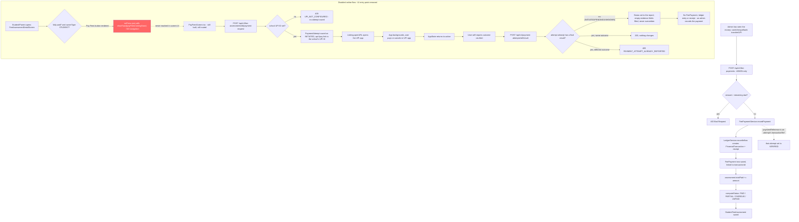

# Fee Payment Recording & the (Disabled) Online Payment Attempt — Flow

## Overview
Gurukul records fee payments an admin has already seen the money for (cash, cheque, bank transfer, or a UPI payment a payer reported from the app). Recording one updates a `StudentFeeAssessment`'s paid amount and status and posts an entry to the general ledger. A second subsystem lets a student or parent start a UPI payment from the app (`PaymentAttempt`, with its own status machine) and report how it went. Its only UI entry point is deliberately disabled: the "Pay Fees" button shows a "coming soon" toast instead of opening the payment screen, because the flow is a raw UPI deep link with no payment gateway behind it, so a "success" is only ever the payer's or UPI app's unverified claim. A payer's report never marks a fee paid: only an admin recording the payment does.

## Actors / roles
- **ADMIN**: Sets the school's UPI ID (and bank details) in Fee Payment Settings. The only role that can record a payment (`POST /api/v1/fee-payments`), and the only role that can confirm a payer-reported attempt (which marks it `VERIFIED`). Can also use the payment-request and attempt endpoints, under the same rules as a payer, and read any receipt.
- **TEACHER**: Sees fee data only for the class-section(s) they are class teacher of: `GET /api/v1/class-sections/{id}/fee-status`, and `GET /api/v1/students/{id}/fee-assessments` for a student currently in that section. Every other fee list, receipt, payment-request and attempt endpoint returns 403 for a teacher.
- **STUDENT**: Can create a payment request, list its attempts and report an attempt's outcome only for their **own** assessment (`FeePaymentService.assertCanPayOrRecord`), and read their own receipts. The disabled "Pay Fees" button is scoped to this role (`canPayFees = session.ownerType === 'STUDENT'`).
- **PARENT**: Same as STUDENT, for a child they are linked to (`ParentService.requireLinkedChild`).
- Any other role (DRIVER, or a role added later) is refused by `assertCanPayOrRecord` ("Only the student, a linked parent or an admin can do this").

## Flow diagram

## Step-by-step

### Recording a payment (admin)
1. An admin who has seen the money calls `recordFeePayment` (`src/api/feePayments.ts`) → `POST /api/v1/fee-payments`. No screen in this app build calls `recordFeePayment` today; the wrapper is there for an admin recording form.
2. `FeePaymentController.recordPayment` delegates to `FeePaymentService.recordPayment(FeePaymentRequest)`, which is ADMIN-only (route rule and a service check).
3. If `paymentReference` is a payment attempt's `transactionRef`, the attempt is locked first. It must belong to the same assessment, and the payment is refused with 400 "A payment has already been recorded for this payment attempt" when the ledger already holds a payment for that attempt.
4. The service loads the `StudentFeeAssessment` scoped to the current `X-School-Id` and rejects (400) an amount above `totalDue - totalPaid`.
5. `LedgerService.recordInflow(...)` records a `FinancialTransaction` (source type `FEE_PAYMENT`) and generates a receipt number. A `FeePayment` row is saved referencing that `transactionId`.
6. `assessment.totalPaid` is incremented and `FeePaymentService.computeStatus` recomputes the status: `PAID` if fully paid, `PARTIAL` if partially paid and not yet overdue, `OVERDUE` if partially paid past `dueDate`, else `UNPAID`.
7. If the payment confirmed an attempt, that attempt is set to `VERIFIED`. This is the only place `VERIFIED` is ever set.
8. The response includes the receipt number.

### Online UPI flow (backend implemented; UI entry point disabled)
9. If a caller reached `PayFeesScreen.tsx` (which nothing in the app navigates to), "Pay Now" first lists the assessment's attempts (`listPaymentAttempts` → `GET /api/v1/fee-assessments/{id}/payment-attempts`) and warns before starting another payment (`earlierAttemptWarning`, `src/utils/feePaymentAttempts.ts`): "Payment already reported" if an attempt is `RESPONSE_SUCCESS` (a reported success the school hasn't confirmed, which no longer marks the fee paid, so the fee still shows its full due), otherwise "Payment already in progress" if one is `INITIATED`/`PENDING`. The payer can cancel or pay again; if the list call fails, the payment starts without a warning. It then calls `createFeePaymentRequest` → `POST /api/v1/fee-assessments/{id}/payment-request`.
10. `FeePaymentService.createPaymentRequest` checks, in order: the assessment is in the school (404), the caller may pay it (403), it isn't already fully paid (400), and the school has a UPI ID set (`upiVpaOverride`, entered as "Your school's UPI ID" in `FeePaymentSettingsScreen.tsx`). With no UPI ID it returns **409 `UPI_NOT_CONFIGURED`** ("This school has not set up UPI payments yet.") and saves nothing; the app shows that message and offers only **Back**, since trying again can't help. Bank account and IFSC are not needed, and the payee address is never guessed from them.
11. On success it builds a `upi://pay?...` link with `pa=` the school's UPI ID and persists a `PaymentAttempt` with status `INITIATED` **before** the UPI app opens, so abandoned attempts are still traceable. The response's `payeeVpa` is that UPI ID; `accountNumber` and `ifsc` are `null` unless the caller is an ADMIN.
12. The frontend calls `Linking.openURL` to hand off to whichever UPI app is installed. React Native's `Linking` API cannot receive a real activity result, so there is no automatic verified outcome.
13. When the app returns to the foreground (`AppState` listener), the user self-reports through an `Alert`: succeeded, cancelled, or not sure → `RESPONSE_SUCCESS` / `CANCELLED` / `UNKNOWN`.
14. That report goes to `POST /api/v1/payment-attempts/{transactionRef}/result` (`FeePaymentService.recordAttemptResult`), which locks the attempt row and applies these rules:
    - The reported `status` must be `RESPONSE_SUCCESS`, `PENDING`, `FAILED`, `CANCELLED` or `UNKNOWN`. `VERIFIED` or `INITIATED` → 400.
    - An attempt still open (`INITIATED`, `PENDING`, `UNKNOWN`) takes the reported status. Each evidence field (`upiTransactionId`, `approvalRefNo`, `responseCode`, `rawResponse`) is filled only if it is still empty, so earlier evidence is never overwritten or cleared.
    - An attempt with a final result (`RESPONSE_SUCCESS`, `FAILED`, `CANCELLED`, `VERIFIED`) returns 200 unchanged when the same outcome is reported again (a `RESPONSE_SUCCESS` report on a `VERIFIED` attempt counts as the same), and **409 `PAYMENT_ATTEMPT_ALREADY_REPORTED`** for a different outcome, writing nothing.
    - A report never records a `FeePayment`, ledger entry or receipt, and never changes the fee. An admin confirms the payment with `POST /api/v1/fee-payments` (steps 1-7).
15. The app shows the returned attempt by its status (`paymentResultKind`): `RESPONSE_SUCCESS` → "Payment response received" with the amount, any UPI transaction id and a caveat that it is unverified and the fee shows as paid once the school confirms; `VERIFIED` (a success report on an attempt an admin already confirmed) → the same success card with "The school has confirmed this payment."; `PENDING` / `UNKNOWN` → their messages with **Done**; `FAILED` / `CANCELLED` → their messages with **Try again** (a fresh payment).
16. On a 409 `PAYMENT_ATTEMPT_ALREADY_REPORTED` (for example, the first report reached the server but its reply was lost, and the payer then reported something else from the manual card), the app lists the attempts again, finds the one whose `transactionRef` is the request's `referenceId`, and shows its stored result as in step 15. If that lookup fails, the error screen shows the 409 message with only **Back** and hides the manual "I've completed this payment" card, since a fresh payment could pay twice.

## Backend endpoints involved
| Endpoint | Roles (route rule) | Service check |
|---|---|---|
| `POST /api/v1/fee-payments` | ADMIN | ADMIN only |
| `GET /api/v1/fee-payments/{id}` (receipt) | ADMIN, STUDENT, PARENT | 404 if not in school, then the student's own receipt, a linked parent's child, or ADMIN; else 403 |
| `POST /api/v1/fee-assessments/{id}/payment-request` | ADMIN, STUDENT, PARENT | `assertCanPayOrRecord`; 409 `UPI_NOT_CONFIGURED` without a UPI ID |
| `GET /api/v1/fee-assessments/{id}/payment-attempts` | ADMIN, STUDENT, PARENT | `assertCanPayOrRecord` |
| `GET /api/v1/fee-assessments/{id}/payment-attempts/pending` | ADMIN, STUDENT, PARENT | `assertCanPayOrRecord` |
| `POST /api/v1/payment-attempts/{transactionRef}/result` | ADMIN, STUDENT, PARENT | `assertCanPayOrRecord`, then the rules in step 14 |
| `GET /api/v1/fee-assessments` | ADMIN | none |
| `GET /api/v1/students/{studentId}/fee-assessments` | ADMIN, TEACHER, STUDENT, PARENT | STUDENT: self. PARENT: linked child. TEACHER: class teacher of the student's current section. ADMIN: any |
| `GET /api/v1/class-sections/{id}/fee-status` | TEACHER, ADMIN | ADMIN, or that section's class teacher |
| any other path under `/fee-assessments/**`, `/fee-payments/**`, `/payment-attempts/**`, `/fee-categories/**`, `/fee-structures/**` | ADMIN (catch-all) | n/a |

`assertCanPayOrRecord` fails closed: no principal (an internal call or a unit test) passes, ADMIN passes, a STUDENT (or a principal with `ownerType == STUDENT`) passes only for its own assessment ("You can only pay your own fees"), a PARENT only for a linked child, and every other role gets 403.

## Frontend screens involved
- `src/screens/principal/FeeAssessmentDetailScreen.tsx` — shows an assessment's totals and status; renders the "Pay Fees" button only when `!fullyPaid && session.ownerType === 'STUDENT'`, but its `onPress` only shows a "coming soon" toast.
- `src/screens/principal/PayFeesScreen.tsx` — the built but unreachable online-payment screen. If reached, it creates a payment request, opens a UPI app via a resolved deep link, waits for the app to come back, asks the user to self-report the outcome, posts it (typed as `PayerReportableStatus`), and shows a result with an explicit "unverified" caveat plus a manual fallback (the school's UPI ID and amount, to pay by hand and then report). Error codes come through `getErrorMessage` (`errors.codes.UPI_NOT_CONFIGURED`, `errors.codes.PAYMENT_ATTEMPT_ALREADY_REPORTED`); for both the error screen shows **Back** instead of **Try again** and no manual-payment card (`canRetryFeePayment`, `src/utils/feePaymentErrors.ts`), and a `PAYMENT_ATTEMPT_ALREADY_REPORTED` first tries to show the stored result (step 16). Pay Now's earlier-attempt warning and the result card's status mapping are in `src/utils/feePaymentAttempts.ts` (steps 9, 15).
- `src/screens/principal/FeePaymentSettingsScreen.tsx` — an admin sets `bankAccountNumber`, `bankIfsc`, `bankAccountHolderName` and the school's UPI ID (`upiVpaOverride`) on the `School` (via `updateSchool`). The UPI ID is what payments go to; the screen says families can pay by UPI only once it is set and that the app never guesses one.
- `src/screens/principal/PaymentReceiptScreen.tsx` — renders and shares a receipt; nothing in this build navigates to it.
- API wrappers: `src/api/feePaymentRequest.ts` (`createFeePaymentRequest`), `src/api/paymentAttempts.ts` (`findPendingPaymentAttempt`, `listPaymentAttempts`, `recordPaymentAttemptResult`), `src/api/feePayments.ts` (`recordFeePayment`, `getFeePayment`).

## Data model
- `StudentFeeAssessment` (`fees.entity.StudentFeeAssessment`): `student`, `academicYear`, `totalDue`, `totalPaid` (default 0), `status` (`FeeAssessmentStatus`), `dueDate`. Unique per `(school_id, student_id, academic_year)`.
- `FeePayment` (`fees.entity.FeePayment`): `assessment` (FK), `amount`, `transactionId` (FK into the finance ledger's `FinancialTransaction`, which carries the receipt number).
- `PaymentAttempt` (`fees.entity.PaymentAttempt`): `assessment` (FK), `transactionRef` (unique, e.g. `FEE<12 hex chars>`), `amount`, `currency` (default `INR`), `status` (`PaymentAttemptStatus`, default `INITIATED`), `upiTransactionId`, `approvalRefNo`, `responseCode`, `rawResponse` (truncated to 2000 chars).
- `PaymentAttemptStatus` enum: `INITIATED`, `RESPONSE_SUCCESS`, `PENDING`, `FAILED`, `CANCELLED`, `UNKNOWN`, `VERIFIED`. `RESPONSE_SUCCESS` is only what the payer or UPI app claimed; `VERIFIED` is set only when an admin records the payment for that attempt.
- `School`: `bankAccountNumber`, `bankIfsc`, `bankAccountHolderName`, `upiVpaOverride` (the school's UPI ID, the only payee a payment request uses; `bankAccountHolderName`, or the school name, is the payee name).

## Known limitations / edge cases
- **The online UPI payment flow is built but disabled in the UI.** In `FeeAssessmentDetailScreen.tsx`, the "Pay Fees" button is rendered (`!fullyPaid && canPayFees`) but its handler only shows `fees.assessmentDetail.payFeesComingSoon` ("Online fee payment is coming soon."). `PayFeesScreen` and its `'PayFees'` route still exist and work against the backend, but nothing navigates to them.
- A payer's report is only a claim. With no payment gateway, nothing verifies it; an admin has to check the money arrived and record the payment.
- Schools without a UPI ID get the 409 once online payment is switched back on in the app; an admin must enter one in Payment Settings first. The app can't confirm the UPI ID's registered payee name (that needs a payment provider).
- Payment Settings still asks for a bank account number and IFSC before it saves, even though a payment request only needs the UPI ID.
- No refund or reversal endpoint exists — a recorded `FeePayment` cannot be voided or corrected through this API.
- Partial payments are allowed with no floor other than `> 0` (`@DecimalMin("0.01")`); a payment above the remaining due is rejected.
