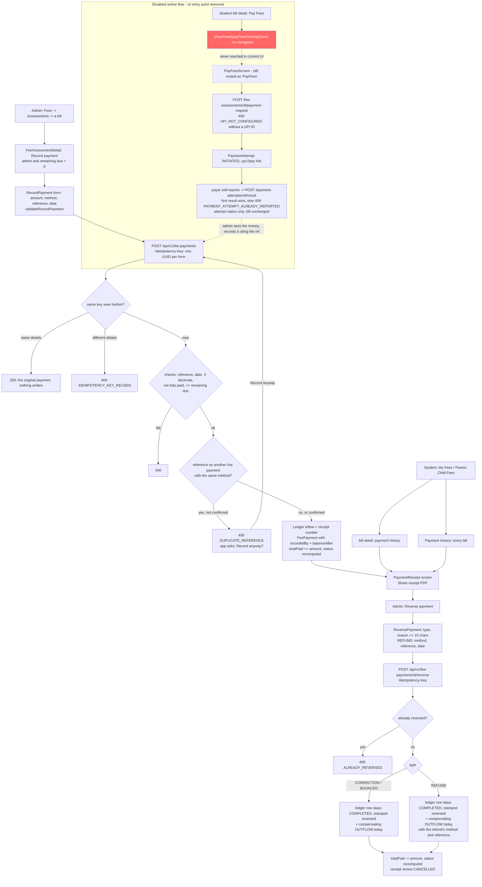

# Fee Payments — Recording, History, Receipts, Reversal, and the (Disabled) Online UPI Attempt — Flow

## Overview
An admin records a fee payment the school has already received (cash, cheque, bank transfer, or a UPI payment made outside the app) from a student's bill in the app. That raises the bill's paid total, recomputes its status, posts an inflow to the finance ledger with a receipt number, and opens the receipt, which can be shared as a server-rendered PDF. Admins and the student's own family (the student and linked parents) can see every payment on a bill or for a student, reversed ones included. An admin can reverse a payment as a **correction** (entered by mistake), a **bounce** (cheque or transfer didn't clear) or a **refund** (money given back); the payment stays on record marked CANCELLED and its receipt number is never reused.

Double taps and retries never record a second payment (an `Idempotency-Key` per form submission), and a UTR or cheque number already on another live payment needs an explicit confirmation. Amounts are never silently rounded (at most 2 decimals) and payment dates are bounded and default to today in India (IST).

A second subsystem lets a student or parent start a UPI payment from the app (a `upi://pay` deep link plus a `PaymentAttempt` row), but its only UI entry point is disabled — the "Pay Fees" button shows a "coming soon" toast — because there is no payment gateway behind it, so a "success" is only the UPI app's unverified claim. A payer's report never marks a fee paid; only an admin recording the payment does.

## Actors / roles
- **ADMIN**: the only role that records or reverses a payment. Reads every bill, payment, receipt and attempt. Sets the school's UPI ID and bank details in Fee Payment Settings.
- **STUDENT**: reads their **own** bills, payment history and receipts (and can download the receipt PDF). May make a payment request and report an attempt's outcome for their own bills. Never sees Record or Reverse.
- **PARENT**: the same as a student, for a **linked** child only (`ParentService.requireLinkedChild`, else 403). Reaches a child's bills from `ChildFees`.
- **TEACHER**: no part in payments — 403 on recording, reversing, history, receipts, the PDF, payment requests and attempts, even as the student's class teacher. Reads one student's bills only as the class teacher of that student's current section, and a section's bills only for their own class-teacher section (see the fees-overview doc).
- **DRIVER** and any other role: 403 on every fee route. Unauthenticated: 401.

## Flow diagram

## Step-by-step

### Recording a payment (admin, in the app)
1. Admin opens Fees → Assessments → a bill (`FeeAssessmentDetailScreen`). **Record payment** shows when `session.role === 'ADMIN'` and the bill's remaining due is above 0; it opens `RecordPaymentScreen` with the bill.
2. The form (header: the student and "Remaining ₹X"):
   - **Amount** — prefilled with the remaining due (`rupeesInputValue`), decimal keypad. Parsed by `parseRupees` (`src/utils/money.ts`): accepts `15000`, `15,000`, `15,000.50`, `₹ 2,500`; refuses more than 2 decimals, signs, exponents and junk. Must be at least ₹0.01 and at most the remaining due.
   - **Method** — Cash (default), UPI, Bank transfer, Cheque (the backend enum; no card).
   - **Reference** — required for everything but cash ("UTR, cheque number or transaction ID"), upper-cased; whitespace is removed before sending, the same way the server stores it.
   - **Date** — defaults to the phone's today (`localToday()`); the picker allows today back to 400 days ago.
   Errors from `validateRecordPayment` (`src/utils/feePayments.ts`) show under each field.
3. **Save** is disabled while saving, and the screen can't be left until the reply arrives: the header Back, Android Back and the iOS swipe only show "Please wait while the payment is saved." (`useHoldWhileSaving`), so the receipt always opens and a second form (with a new key) can't record the same payment again. The request carries `Idempotency-Key: <UUID v4>` (`newIdempotencyKey`). The key is kept while the form is unchanged — a retry after a timeout or lost connection sends the same key — and any field edit clears it.
4. `POST /api/v1/fee-payments` (ADMIN), body `{assessmentId, amount, paymentMethod, paymentReference?, transactionDate?, confirmDuplicateReference?}`. In order, the first failure wins and nothing is written:
   - bean validation (amount ≥ 0.01, at most 2 decimals — `100.100` counts as `100.10`; reference ≤ 100 chars) or a malformed key (`^[A-Za-z0-9_-]{8,64}$`) → 400; not ADMIN → 403;
   - non-cash with no reference → 400 "Enter the UTR, cheque or transaction number for this payment.";
   - a date after IST today → 400 "The payment date can't be in the future."; before IST today − 400 days → 400 "…can't be more than 400 days ago."; no date → IST today;
   - if the reference is a `PaymentAttempt.transactionRef` in this school, that attempt is locked; then the bill is locked (404 "Fee assessment not found" if not in the school);
   - **repeat check** (with a key): a ledger row in this school with that `client_request_id` that is this bill's payment with the same amount, method, normalised reference (and date, when sent) → **200 with that payment** and nothing written; anything else → **409 `IDEMPOTENCY_KEY_REUSED`**. Without the header there's no repeat protection (old behaviour);
   - attempt checks: another bill's attempt → 400; a **non-reversed** payment already carries the attempt's reference → 400 "A payment has already been recorded for this payment attempt";
   - remaining due ≤ 0 → 400 "This fee bill is already fully paid."; amount > remaining → 400 "Payment amount exceeds remaining due: <remaining>";
   - **duplicate reference**: not cash, not confirmed, and a live (not reversed) fee inflow in this school with the same method and reference → **409 `DUPLICATE_REFERENCE`**, `data` = the newest match `{existingPaymentId, existingReceiptNumber, existingStudentName, existingAmount, existingTransactionDate}`. Same method only — a 6-digit cheque number can match another bank's cheque.
5. On success, one transaction: `LedgerService.recordInflow(FEE_PAYMENT, …)` (receipt number; `client_request_id` = the key), a `FeePayment` with `recordedById`/`recordedByName` (the admin's employee name) and `balanceAfter` (remaining − amount), `totalPaid += amount`, `computeStatus` (IST today), and a confirmed attempt becomes `VERIFIED`. Response 200 "Payment recorded" with the full receipt (`FeePaymentResponse`).
6. The app: on `DUPLICATE_REFERENCE` an alert says "<ref> is already on receipt <no> (<student>, <date>, <amount>). Record this payment anyway?" — **Record anyway** resends the same form with `confirmDuplicateReference: true` (same key; nothing was written). On `IDEMPOTENCY_KEY_REUSED` the key is dropped and a toast shown. Any other error is a toast (`getErrorMessage`). On success the screen is replaced by `PaymentReceipt { payment }`.

### Receipts
7. `PaymentReceiptScreen` takes `{ payment }` or `{ paymentId }` and fetches `GET /api/v1/fee-payments/{id}` on every focus (loading and error-with-retry when it only has an id). It shows the school logo (when `schoolLogoUrl` is set) and name, receipt number, date, student, roll, class (the student's **current** class), fee bill (academic year), method, reference, received by (when known), amount (`₹15,000.00`) and balance due after this payment (when known).
8. A reversed payment shows a red **CANCELLED** banner: the type ("Entered by mistake" / "Cheque or transfer bounced" / "Refunded"), "Cancelled on <date> by <name>", for a refund "Refunded by <method>, ref <ref>, on <date>" (the day the refund was entered), and the reason.
9. **Share receipt (PDF)** downloads `GET /api/v1/fee-payments/{id}/receipt.pdf` into the cache (`downloadFeeReceiptPdf`, with the bearer token) and opens the share sheet (`usePdfDownload`). The PDF is A5, Noto Sans (+ Devanagari), with the logo or school name, the same rows, an "Amount received" box with the balance after, a diagonal CANCELLED watermark and a red cancellation box once reversed, and a "Generated on <IST date>" footer. File name `fee-receipt-<receipt-number-slug>.pdf` (or the id's first 8 characters).
10. An admin sees **Reverse payment** while the payment isn't reversed. **Done** and the header back arrow go back to wherever the receipt was opened from.
11. Receipt access (JSON and PDF): 404 "Fee payment not found" when not in the school, then ADMIN, the payment's own student or a linked parent; anyone else 403. Checked inside the service transaction; the PDF renders only from the checked DTO.

### Payment history
12. `FeeAssessmentDetailScreen` refetches its bill on focus (`listStudentFeeAssessments`, matched by id — `refreshedBill`). If that fails, or the bill isn't in the list, it keeps the bill it has and shows "Could not refresh this bill, so the amounts shown may be out of date." with **Retry** above the totals; the notice goes on the next successful refetch. For an admin, student or parent it for an admin, student or parent, shows a **Payment history** section (`FeePaymentHistory` with the bill id → `GET /api/v1/fee-assessments/{id}/payments`) and a link **All payments for this student** → `StudentFeePaymentsScreen`.
13. `StudentFeePaymentsScreen` lists every payment on every bill of the student (`GET /api/v1/students/{studentId}/fee-payments`), each with its academic year. Reached from My Fees (student, "Payment history"), Child Fees (parent, "Payment history") and the bill detail.
14. Each row: receipt number, date (and academic year), method · reference, "by <recorded by>", amount; a reversed payment is struck through with a red **Cancelled** chip. Tapping opens the receipt. Loading, "No payments recorded yet." and error-with-retry states; the list reloads on focus.
15. Both list endpoints: 404 (bill / "Student not found") when not in the school, then ADMIN, own student or linked parent, else 403. Newest first by payment date, then created time; not paginated; `schoolLogoUrl` is null in list rows.

### Reversing a payment (admin)
16. Receipt → **Reverse payment** → `ReversePaymentScreen` (receipt number, amount, method, date):
    - **What happened?** — radio options from `reversalTypesFor(method)`: Entered by mistake (CORRECTION), Cheque or transfer bounced (BOUNCED — not offered for cash), Refunded (REFUND), each with a one-line explanation.
    - **Reason** — at least 10 characters (counter shown), at most 500.
    - **Refund only** — refund method and refund reference (required for every method; for cash a voucher or slip number). There is no refund date: a note says the refund is entered in the books today, the day it's saved.
    Submit asks "Cancel receipt <no>? <amount> will be taken off <student>'s paid total. This can't be undone.", is disabled while saving, holds the screen until the reply like recording does ("Please wait while the payment is reversed."), and uses the same idempotency-key rule as recording.
17. `POST /api/v1/fee-payments/{id}/reverse` (ADMIN), body `{type, reason, refundMethod?, refundReference?}` (refund fields ignored unless REFUND; a `refundDate` an older client sends is ignored). In order: 400 validation / bad key, 403 not admin; 400 reason under 10 characters after trimming; 400 "A refund needs the refund method and reference."; 404 "Fee payment not found"; lock the bill, then the ledger row; repeat check (same key + same type → 200 with the current payment; same key, other type, or the key on another row → 409 `IDEMPOTENCY_KEY_REUSED`); **409 `ALREADY_REVERSED`** "This payment was already reversed." with `data {receiptNumber, reversedAt, reversalType}`; 400 "A cash payment can't bounce."; bill paid total below the payment → 400.
18. Effects, one transaction (`LedgerService.reverse`), the accounting-safe way (`specs/ledger-and-receipts` P2) for every type:
    - The payment's own ledger row is never changed: it stays a `COMPLETED` inflow with its amount, and is stamped reversed (`reversed_at`, `reversed_by_id`, `reversed_by_name`, `reversal_type`, `reversal_reason`, `reversal_request_id`).
    - One compensating OUTFLOW is posted against it: the same amount and source, `reversal_of_id` = the original, no receipt number, dated IST today (the original's date if that were later), `status = COMPLETED`. For CORRECTION / BOUNCED it has the payment's method and no reference, notes "Reversal of receipt <no>: <reason>"; for a REFUND, the refund's method and reference, notes "Refund of receipt <no>: <reason>". Its id is `reversal.reversalTransactionId` (and `refundTransactionId` for a refund).
    - The bill's `totalPaid -= amount` and its status is recomputed. The `FeePayment` row, its receipt number and any attempt status are left as they are; the receipt sequence never goes back, so the number is never reused.
19. The app: success → toast "Payment reversed." and back to the receipt with the reversed payment (`navigate(..., merge: true)`), now CANCELLED. `ALREADY_REVERSED` → toast and back (the receipt refetches).

| Action | Original ledger row | New ledger row | `GET /finance/summary` | Bill and dues |
|---|---|---|---|---|
| Record | INFLOW, COMPLETED, receipt number | — | inflow +A | `totalPaid` +A |
| CORRECTION / BOUNCED | stays COMPLETED, reversal fields stamped | OUTFLOW, COMPLETED, today, the payment's method | inflow unchanged, outflow +A, net back to before the payment | `totalPaid` −A, status recomputed |
| REFUND | same | OUTFLOW, COMPLETED, today, the refund's method and reference | same | same |

A ledger row is **cancelled** when `reversed_at` is set; a row with `reversal_of_id` is the **compensating** row of that original. Both stay `COMPLETED` and count in totals, so they net to zero and no earlier day's balance changes. `TransactionStatus.REVERSED` is unused.

### Online UPI flow (backend works; UI entry point disabled)
20. A student reaches the bill detail from My Fees. "Pay Fees" only shows "Online fee payment is coming soon.". `PayFeesScreen` is still registered as `'PayFees'`, but nothing navigates to it. If it were reached, "Pay Now" sets a busy flag at once and shows "Preparing…" (a double tap can't start two attempts), then lists the bill's attempts (`listPaymentAttempts` → `GET /api/v1/fee-assessments/{id}/payment-attempts`) and warns before starting another payment (`earlierAttemptWarning`, `src/utils/feePaymentAttempts.ts`): "Payment already reported" if an attempt is `RESPONSE_SUCCESS` (a reported success the school hasn't confirmed, which doesn't mark the fee paid, so the fee still shows its full due), otherwise "Payment already in progress" if one is `INITIATED`/`PENDING`. The payer can cancel or pay again. If the list call fails, the error is shown instead of starting a payment anyway. It then calls `createFeePaymentRequest` → `POST /api/v1/fee-assessments/{id}/payment-request`. The Pay button is disabled except when idle or after an error, and the amount shown switches to the server's `paymentRequest.amount` once a request exists.
21. `FeePaymentService.createPaymentRequest` checks, in order: the assessment is in the school (404), the caller may pay it (403 — admin, the student, or a linked parent; every other role, a teacher included, is refused), it isn't already fully paid (400), and the school has a UPI ID set (`upiVpaOverride`, entered as "Your school's UPI ID" in `FeePaymentSettingsScreen.tsx`). With no UPI ID it returns **409 `UPI_NOT_CONFIGURED`** ("This school has not set up UPI payments yet.") and saves nothing; the app shows that message and offers only **Back**, since trying again can't help. Bank account and IFSC are not needed, and the payee address is never guessed from them.
22. On success it builds a `upi://pay?...` link with `pa=` the school's UPI ID and persists a `PaymentAttempt` (`transactionRef = FEE<12 hex>`, amount = remaining due) with status `INITIATED` **before** the UPI app opens, so abandoned attempts are still traceable. The response's `payeeVpa` is that UPI ID; `accountNumber` and `ifsc` are `null` unless the caller is an ADMIN.
23. The frontend calls `Linking.openURL` to hand off to whichever UPI app is installed. React Native's `Linking` API cannot receive a real activity result, so there is no automatic verified outcome.
24. When the app returns to the foreground (`AppState` listener), the user self-reports through an `Alert`: succeeded, cancelled, or not sure → `RESPONSE_SUCCESS` / `CANCELLED` / `UNKNOWN`.
25. That report goes to `POST /api/v1/payment-attempts/{transactionRef}/result` (`FeePaymentService.recordAttemptResult`), which locks the attempt row and applies these rules:
    - The reported `status` must be `RESPONSE_SUCCESS`, `PENDING`, `FAILED`, `CANCELLED` or `UNKNOWN`. `VERIFIED` or `INITIATED` → 400.
    - An attempt still open (`INITIATED`, `PENDING`, `UNKNOWN`) takes the reported status. Each evidence field (`upiTransactionId`, `approvalRefNo`, `responseCode`, `rawResponse`) is filled only if it is still empty, so earlier evidence is never overwritten or cleared.
    - An attempt with a final result (`RESPONSE_SUCCESS`, `FAILED`, `CANCELLED`, `VERIFIED`) returns 200 unchanged when the same outcome is reported again (a `RESPONSE_SUCCESS` report on a `VERIFIED` attempt counts as the same), and **409 `PAYMENT_ATTEMPT_ALREADY_REPORTED`** for a different outcome, writing nothing.
    - A report never records a `FeePayment`, ledger entry or receipt, and never changes the fee.
26. The app shows the returned attempt by its status (`paymentResultKind`): `RESPONSE_SUCCESS` → "Payment response received" with the amount, any UPI transaction id and a caveat that it is unverified and the fee shows as paid once the school confirms; `VERIFIED` (a success report on an attempt an admin already confirmed) → the same success card with "The school has confirmed this payment."; `PENDING` / `UNKNOWN` → their messages with **Done**; `FAILED` / `CANCELLED` → their messages with **Try again** (a fresh payment).
27. On a 409 `PAYMENT_ATTEMPT_ALREADY_REPORTED` (for example, the first report reached the server but its reply was lost, and the payer then reported something else from the manual card), the app lists the attempts again, finds the one whose `transactionRef` is the request's `referenceId`, and shows its stored result as in step 26. If that lookup fails, the error screen shows the 409 message with only **Back** and hides the manual "I've completed this payment" card, since a fresh payment could pay twice.
28. To confirm a reported payment, an admin records it (step 4) with the attempt's `transactionRef` as the reference; the attempt becomes `VERIFIED` (the only place that status is set). "Already recorded" is decided only from the ledger, never from the attempt's status. Once that payment is reversed, the attempt can be confirmed again with the same reference (only non-reversed payments block it); the attempt stays `VERIFIED`.

### Fee-due reminders
29. `FeeDueAlertService.runDaily` (default 09:00 IST) pushes `FEE_DUE` to linked parents of ACTIVE students with a positive balance: once from 3 days before the due date, then once a week while overdue. Tapping opens `ChildFees`.

## Backend endpoints involved
All matchers are in `SecurityConfig`'s fee block; `…/receipt.pdf` and `…/reverse` are separate patterns from `/fee-payments/*`. These specific rules sit before the ADMIN-only fee catch-all.

| Endpoint | Route rule | Service check |
|---|---|---|
| `POST /api/v1/fee-payments` (optional `Idempotency-Key`) | ADMIN | `assertStaffCanRecord`; step 4 |
| `GET /api/v1/fee-payments/{id}` | ADMIN, STUDENT, PARENT | step 11 |
| `GET /api/v1/fee-payments/{id}/receipt.pdf` | ADMIN, STUDENT, PARENT | step 11 |
| `POST /api/v1/fee-payments/{id}/reverse` (optional `Idempotency-Key`) | ADMIN | admin; step 17 |
| `GET /api/v1/fee-assessments/{id}/payments` | ADMIN, STUDENT, PARENT | step 15 |
| `GET /api/v1/students/{studentId}/fee-payments` | ADMIN, STUDENT, PARENT | step 15 |
| `POST /api/v1/fee-assessments/{id}/payment-request` | ADMIN, STUDENT, PARENT | step 21 |
| `GET /api/v1/fee-assessments/{id}/payment-attempts/pending` | ADMIN, STUDENT, PARENT | own student / linked parent / admin; `data: null` when none |
| `GET /api/v1/fee-assessments/{id}/payment-attempts` | ADMIN, STUDENT, PARENT | same; newest first |
| `POST /api/v1/payment-attempts/{transactionRef}/result` | ADMIN, STUDENT, PARENT | step 25 |
| `GET /api/v1/fee-assessments` | ADMIN | none (school-wide list) |
| `GET /api/v1/students/{studentId}/fee-assessments` | ADMIN, TEACHER, STUDENT, PARENT | STUDENT: self. PARENT: linked child. TEACHER: class teacher of the student's current section. ADMIN: any |
| `GET /api/v1/class-sections/{id}/fee-status` | TEACHER, ADMIN | ADMIN, or that section's class teacher |
| any other path under `/fee-assessments/**`, `/fee-payments/**`, `/payment-attempts/**`, `/fee-categories/**`, `/fee-structures/**` | ADMIN (catch-all) | n/a |

`requireAdminOrFamily` (behind `assertCanPayOrRecord` and every payment read) fails closed: no principal (an internal call or a unit test) passes, ADMIN passes, a STUDENT (or a principal with `ownerType == STUDENT`) passes only for its own student, a PARENT only for a linked child, and every other role gets 403.

Error codes: `DUPLICATE_REFERENCE`, `ALREADY_REVERSED`, `IDEMPOTENCY_KEY_REUSED`, `UPI_NOT_CONFIGURED` and `PAYMENT_ATTEMPT_ALREADY_REPORTED` (all 409; the app has its own wording for each under `errors.codes`). Old app builds call neither the new endpoints nor `POST /fee-payments`; the added response fields are additive.

## Frontend screens involved
- `src/screens/principal/FeeAssessmentDetailScreen.tsx` — bill totals (`formatRupees`), progress bar, status; refetched on focus. Admin: **Record payment**. Admin/student/parent: payment history and "All payments for this student". Student: the disabled "Pay Fees" toast. Registered in `PrincipalNavigator` and `ParentNavigator`.
- `src/screens/principal/RecordPaymentScreen.tsx` (admin) — step 2–6.
- `src/screens/principal/PaymentReceiptScreen.tsx` — steps 7–10 (no client-side HTML/expo-print receipt any more).
- `src/screens/principal/ReversePaymentScreen.tsx` (admin) — steps 16 and 19.
- `src/screens/principal/StudentFeePaymentsScreen.tsx` — step 13 (both navigators).
- `src/components/FeePaymentHistory.tsx` — the list used by the bill detail and StudentFeePayments.
- `src/screens/principal/MyFeesScreen.tsx` (student) — own bills; "Payment history" button; rows open the bill detail.
- `src/screens/principal/ChildFeesScreen.tsx` (parent) — a child's bills; rows now open the bill detail; "Payment history" button.
- `src/screens/principal/PayFeesScreen.tsx` — the unreachable online-payment screen (steps 20–27). For `UPI_NOT_CONFIGURED` and `PAYMENT_ATTEMPT_ALREADY_REPORTED` the error screen shows **Back** instead of **Try again** and no manual-payment card (`canRetryFeePayment`, `src/utils/feePaymentErrors.ts`); the earlier-attempt warning and the result card's status mapping are in `src/utils/feePaymentAttempts.ts`.
- `src/screens/principal/FeePaymentSettingsScreen.tsx` — the school's UPI ID and bank details.
- API: `src/api/feePayments.ts` (`recordFeePayment`, `getFeePayment`, `listBillPayments`, `listStudentPayments`, `reverseFeePayment`, `downloadFeeReceiptPdf`), `src/api/client.ts` (`api.post(…, { headers })` — extra headers are re-sent unchanged on the 401 refresh retry), `src/api/feePaymentRequest.ts` (`createFeePaymentRequest`), `src/api/paymentAttempts.ts` (`findPendingPaymentAttempt`, `listPaymentAttempts`, `recordPaymentAttemptResult`).
- Helpers (unit-tested): `src/utils/money.ts` (`parseRupees`, `formatRupees` with Indian grouping and no `Intl`, `sumRupees` in paise, `rupeesInputValue`), `src/utils/feePayments.ts` (methods, reference rules, date bounds, `validateRecordPayment`, `reversalTypesFor`, `validateReversal`, `duplicateReferenceInfo`, `refreshedBill`), `src/utils/idempotencyKey.ts`. Hook: `src/hooks/useHoldWhileSaving.ts` (`usePreventRemove` while a record or reverse request is in flight).

## Data model
- `StudentFeeAssessment`: `student`, `academicYear`, `totalDue`, `totalPaid`, `status` (`UNPAID`, `PARTIAL`, `PAID`, `OVERDUE`; computed against IST today), `dueDate`.
- `FeePayment`: `assessment`, `amount`, `transactionId` (the ledger row), and new `recordedById`, `recordedByName`, `balanceAfter` — snapshots taken when recorded; null for payments recorded before this change, so those receipts hide "Received by" and the balance row.
- `FinancialTransaction` (ledger) gains `client_request_id` and `reversal_request_id` (unique per school; NULLs never collide), `reversed_at`, `reversed_by_id`, `reversed_by_name`, `reversal_type` (`CORRECTION`/`BOUNCED`/`REFUND`), `reversal_reason`, `reversal_of_id` (a compensating row → its original). A reversed row keeps `status = COMPLETED`; `TransactionStatus.REVERSED` is unused. Migration `V88__fee_payments_in_app.sql` (every column and index `IF NOT EXISTS`, the reversal ones shared with the ledger-and-receipts migration). A payment's method, reference, date and receipt number live on its ledger row; references are stored without whitespace, upper-cased.
- `PaymentAttempt`: `assessment`, `transactionRef` (`FEE<12 hex>`), `amount`, `currency`, `status` (`INITIATED`; payer reports `RESPONSE_SUCCESS`/`PENDING`/`FAILED`/`CANCELLED`/`UNKNOWN`; `VERIFIED` only via an admin's recording), evidence fields (`upiTransactionId`, `approvalRefNo`, `responseCode`, `rawResponse` ≤ 2000 chars).
- `School`: `upiVpaOverride` (the school's UPI ID, the only payee a payment request uses), `bankAccountNumber`, `bankIfsc`, `bankAccountHolderName` (or the school name: the payee name).

## Known limitations / edge cases
- **Online UPI flow built, then disabled in the UI** (step 20). No gateway; there is no claimed-UPI verification queue — an admin records the payment once they see the money.
- A cheque counts as cleared when it's entered; there is no PENDING-until-cleared state and no bounce charge. A bounce is handled as a BOUNCED reversal.
- No partial refunds: correct the payment, then record the right amount.
- The receipt's class is the student's **current** class (nothing stores the class at payment time).
- The idempotency key is per unchanged form: a save that timed out and is retried after editing the amount is a different payment (the duplicate-reference check still catches a reused UTR).
- A cash refund needs a reference too (a voucher or slip number).
- "Today" in the app is the phone's date; the server checks against IST, so a phone set to a zone ahead of India could have tomorrow's date refused.
- Receipts have no fee-category / tuition (80C) breakdown and no amount in words.
- `findPendingAttempt` treats only `INITIATED`/`PENDING` as in flight, not `UNKNOWN`; the backend doesn't yet refuse a new payment request while a recent attempt is open.
- Schools without a UPI ID get the 409 once online payment is switched back on in the app; an admin must enter one in Payment Settings first. The app can't confirm the UPI ID's registered payee name (that needs a payment provider).
- Payment Settings still asks for a bank account number and IFSC before it saves, even though a payment request only needs the UPI ID.

## Known gaps
- `src/utils/money.ts` now holds both the fee helpers (`parseRupees`, `formatRupees`) and the expense/vendor/payroll ones (`parseInrAmount`, `formatInr`), sharing `toPaise`. Some fee screens outside this change (fee assessment and structure lists, fee structure detail, My Class Fees) still format with `toLocaleString('en-IN')` and should move to it.
- Idempotency covers only recording and reversing fee payments; sponsorship, collection and manual-ledger POSTs don't use `client_request_id` yet.
