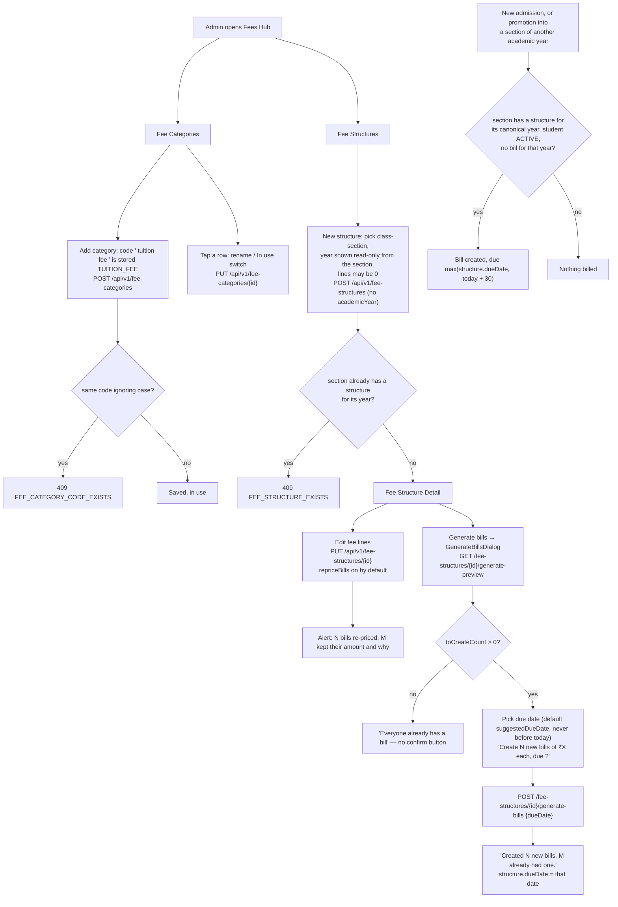

# Fee Structure Setup & Bill Generation — Flow

## Overview
A school keeps a catalog of fee categories (e.g. `TUITION`, `TRANSPORT`), sets per-category amounts on a fee structure for one class-section (for that section's own academic year), and then generates a `StudentFeeAssessment` (a per-student bill) for every active student in the section, due on a date the admin picks. A structure's lines can be edited later, optionally re-pricing the bills nobody has paid or adjusted yet. Categories can be renamed or taken out of use. Generation is idempotent per student and academic year, and a student who joins later — a new admission, or a promotion into a section of a new academic year — is billed automatically when their section has a structure. Correcting one bill (concessions, due dates, cancelling) is in [fees-overview](../fees-overview/FLOW.md).

Source: `specs/fee-bills-and-dues` (finance fix 4). Statements about the server follow that spec's API contract.

## Actors / roles
- **ADMIN**: The only role that creates or edits categories and structures and generates bills (`SecurityConfig` `hasRole("ADMIN")` on every write, plus the ADMIN catch-all for unlisted fee paths). Screens live under `src/screens/principal/`, reached from the dashboard's "Fees" tile → `FeesHubScreen`.
- **TEACHER**: May **read** fee categories and structures (`GET` is `hasAnyRole("TEACHER", "ADMIN")`) but has no UI entry point (the "Fees" tile is hidden from teachers). Every write is 403.
- **STUDENT / PARENT**: No screen; every endpoint here is 403.
- No token: 401.

## Flow diagram

## Step-by-step

### Categories
1. `FeeCategoriesListScreen` lists every category (`GET /api/v1/fee-categories`, ordered by code, active and inactive). A category not in use is greyed with a "Not in use" tag.
2. "+ Add category" opens an inline form shared with the picker on the structure form (`useCreateFeeCategory`). Under the code field the app shows what will be stored (`normaliseCategoryCode`: trimmed, upper-cased, runs of spaces/hyphens → `_`, must be 2-30 of `A-Z 0-9 _`). The server applies the same rule and refuses a code equal to an existing one ignoring case with **409 `FEE_CATEGORY_CODE_EXISTS`** (shown through `errors.codes`). Existing codes are not rewritten.
3. Tapping a row opens an inline edit: the name (1-100 characters) and an "In use" switch → `PUT /api/v1/fee-categories/{id}` `{name, active}`. The code never changes. A category not in use can't be put on a **new** structure line (400 "Fee category X is no longer in use"); lines that already have it keep working.
4. `FeeCategoryPicker` (on the structure form) offers only categories in use, plus the one already on that line (`pickableCategories`). With none to offer it says "No fee categories yet.", or, when every category is marked not in use, to turn one back on in Fee Categories or add a new one (`categoryPickerEmptyKey`).

### Creating a structure
5. `FeeStructureFormScreen` (no route params): pick a class-section; the section's academic year shows read-only in its canonical form (`2026-27`). The app does not send `academicYear`: the server stores `canonicalOrTrimmed(section.academicYear)`. An old build that still sends a year gets 400 "This class-section is for academic year 2026-27" if it differs from the section's.
6. Lines: 1-50, one per category (400 "Each fee category can appear only once"), amount ≥ 0 with at most 2 decimals. 0 is allowed (a fee this class doesn't charge, e.g. RTE students). The app parses amounts with `parseAmountInput` (commas/spaces ignored), checks the same rules (`feeLinesError`) and shows the running total.
7. A second structure for the same section and year → **409 `FEE_STRUCTURE_EXISTS`** ("Edit that one instead").

### Editing a structure
8. On `FeeStructureDetailScreen`, "Edit fee lines" opens `FeeStructureFormScreen` with `{ feeStructure }`: the section is fixed, the lines are prefilled, and a switch "Also update bills that have no payments or adjustments yet" defaults on.
9. Save → `PUT /api/v1/fee-structures/{id}` `{lines, repriceBills}`. The server locks the structure row, replaces the lines (changed amounts updated, removed lines deleted, new ones inserted), and — when `repriceBills` — re-prices each bill of this structure (non-cancelled bills for its academic year of students whose **current** section is the structure's section) that has `totalPaid == 0` and no adjustments: `baseAmount = totalDue = new total`, status recomputed. Each bill is row-locked and saved as an entity, so the audit log records it.
10. The result (`FeeStructureUpdateResult`) gives `repricedCount`, `leftAloneCount` and up to 100 `leftAlone` bills with a reason (`HAS_PAYMENTS`, `HAS_ADJUSTMENTS`, `NOT_REQUESTED`). The app shows it in an alert (`structureUpdateMessage`; the per-reason breakdown only when the list is complete) and goes back; the detail screen re-fetches the structure on focus.

### Generating bills
11. "Generate bills for this class" opens `GenerateBillsDialog`, which fetches `GET /api/v1/fee-structures/{id}/generate-preview`: `activeStudentCount`, `toCreateCount`, `alreadyBilledCount`, `alreadyBilledDifferentTotal` (names and amounts), `inactiveStudentCount`, `structureDueDate`, `suggestedDueDate`.
12. With bills to create, it shows a date picker (default `suggestedDueDate`, kept between today and two years ahead) and the confirmation from `generateConfirmation`: "Create 40 new bills of ₹20,000 each, due 10 Nov 2026?", "2 students already have a bill (1 for a different amount: Asha).", "3 withdrawn students won't be billed.". With nobody to bill it says "Everyone already has a bill" (or "There are no active students in this class yet") and offers no confirm button.
13. Confirm → `POST /api/v1/fee-structures/{id}/generate-bills` `{dueDate}` (required, today to today + 2 years, IST; slow timeout). The server locks the structure row, sets `structure.dueDate`, and bills only ACTIVE students without a bill for that year: `baseAmount = totalDue = totalPerStudent`, the chosen due date, status by the shared rule. The result (`GenerateBillsResult`) is shown as "Created 40 new bills. 2 already had one." and the structure is re-fetched (its due date now shows).
14. The legacy `POST /api/v1/fee-structures/{id}/generate-assessments` stays for installed builds: `dueDate` optional (default today + 30, IST) and its `data` is now **only the bills this call created**, so an old build's "Generated N assessments" is truthful (0 on a re-run). This app no longer calls it.

### Students joining later
15. `StudentService.createEntity` (new student, bulk import, admission conversion) calls `FeeStructureService.createAssessmentForStudentIfStructureExists`, which finds the structure by section id and the section's **canonical** year — so a `2026-2027` section finds its `2026-27` structure.
16. Moving a student (`PATCH /students/{id}/class-section`, or `PUT /students/{id}` with a new section): same canonical year → nothing changes, the student keeps their bill. A different year and the student ACTIVE → the same hook bills them for the new year if that section has a structure and they have no bill for it.
17. A later bill's due date is the later of `structure.dueDate` and today + 30 days (IST); today + 30 when the structure has none.

## Backend endpoints involved
| Endpoint | Roles | Notes |
|---|---|---|
| `GET /api/v1/fee-categories` | TEACHER, ADMIN | all categories, `active` flag, ordered by code |
| `POST /api/v1/fee-categories` | ADMIN | code normalised; 409 `FEE_CATEGORY_CODE_EXISTS` |
| `PUT /api/v1/fee-categories/{id}` | ADMIN | `{name, active?}`; code ignored |
| `GET /api/v1/fee-structures`, `GET /api/v1/fee-structures/{id}` | TEACHER, ADMIN | `dueDate`, `totalPerStudent`, canonical `academicYear` |
| `POST /api/v1/fee-structures` | ADMIN | `academicYear` optional; 409 `FEE_STRUCTURE_EXISTS` |
| `PUT /api/v1/fee-structures/{id}` | ADMIN | `{lines, repriceBills}` → `FeeStructureUpdateResult` |
| `GET /api/v1/fee-structures/{id}/generate-preview` | ADMIN | `GeneratePreview` |
| `POST /api/v1/fee-structures/{id}/generate-bills` | ADMIN | `{dueDate}` required → `GenerateBillsResult` |
| `POST /api/v1/fee-structures/{id}/generate-assessments` | ADMIN | legacy; only newly created bills returned |

## Frontend screens involved
- `FeesHubScreen.tsx` — menu to categories, structures, bills and payment settings.
- `FeeCategoriesListScreen.tsx` — list, create (`useCreateFeeCategory`), inline rename / in-use switch (`updateFeeCategory`).
- `FeeStructuresListScreen.tsx` — lists structures, links to the form and detail.
- `FeeStructureFormScreen.tsx` — create (`createFeeStructure`, no year sent) or edit (`updateFeeStructure`); year read-only; 0 amounts allowed.
- `FeeStructureDetailScreen.tsx` — re-fetches on focus; lines, total and due date from the server; "Edit fee lines"; "Generate bills" → `src/components/fees/GenerateBillsDialog.tsx`.
- `src/components/FeeCategoryPicker.tsx` — categories in use plus the selected one; quick create.
- Helpers in `src/utils/feeBills.ts` (unit-tested in `src/__tests__/feeBills.test.ts`): `normaliseCategoryCode`, `pickableCategories`, `feeLinesError`/`feeLinesRequest`/`feeLinesTotal`, `canonicalAcademicYear`, `generateConfirmation`, `generateResultText`, `structureUpdateMessage`, `generateDueDateBounds`, `formatAmount`/`parseAmountInput`.
- API wrappers: `src/api/feeCategories.ts` (`listFeeCategories`, `createFeeCategory`, `updateFeeCategory`), `src/api/feeStructures.ts` (`listFeeStructures`, `getFeeStructure`, `createFeeStructure`, `updateFeeStructure`, `getGeneratePreview`, `generateBills`).

## Data model
- **FeeCategory**: `code` (unique per school; new codes also unique ignoring case, checked in the service), `name`, `active` (default true).
- **FeeStructure**: `classSection`, `academicYear` (canonical `YYYY-YY`), `dueDate` (nullable; the date chosen at the last Generate). Unique on `(school_id, class_section_id, academic_year)`.
- **FeeStructureLine**: `feeCategory`, `amount` (≥ 0, 12/2). One per category per structure.
- **StudentFeeAssessment**: `baseAmount` (the structure's total when billed), `totalDue` (= base + adjustments), `totalPaid`, `status`, `dueDate`, `academicYear` (canonical), cancel fields. Unique on `(school_id, student_id, academic_year)`. There is no `fee_structure_id`: a structure's bills are found by section and year.
- The migration normalises existing fee rows' `YYYY-YYYY` years to `YYYY-YY`, skipping any row that would collide with an existing canonical row. `class_section.academic_year` is not rewritten (exams, timetable and battle rooms compare it as text).

## Known limitations / edge cases
- **One due date per bill**: no instalments (follow-up). Moving the due date of all of a structure's bills at once isn't possible; each bill's date can be changed on its own.
- **Re-pricing follows the student's current section.** A bill whose student has since moved section isn't in the structure's scope and isn't re-priced.
- **Categories can't be deleted**, only taken out of use.
- **Academic years are April-March by IST date** for every school (no per-school start month).
- An old app build's academic-year dropdown can pick a year other than the section's; the server now refuses that with 400.
