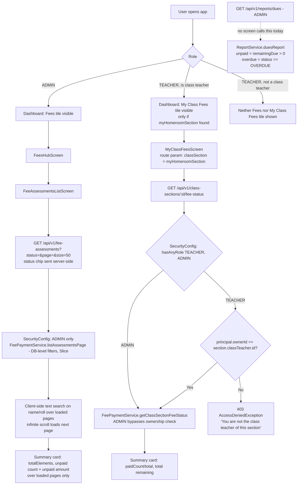

# Fees Overview & My Class Fees — Flow

## Overview
This feature gives two different audiences a read-only view over `StudentFeeAssessment` records: a school-wide "Fee Assessments" list for the principal/admin (with status filter chips and search), and a scoped "My Class Fees" view that a homeroom teacher uses to see dues for only their own section. Both screens render the same underlying `FeeAssessmentResponse` shape (student name, roll number, total/paid/remaining due, status), but they hit different backend endpoints, each with its own server-side authorization rule. A separate, currently backend-only "dues report" endpoint aggregates unpaid/overdue totals school-wide but has no consuming screen in the app today.

## Actors / roles
- **ADMIN**: Full access — sees every fee assessment in the school via `FeeAssessmentsListScreen`, can query any class-section's fee status, and is the only role allowed on `GET /api/v1/fee-assessments` and `GET /api/v1/reports/dues` (the latter unconsumed by any screen).
- **TEACHER**: Reached via the dashboard's "My Class Fees" tile, which only appears if the teacher is the `classTeacher` of some section (`myHomeroomSection`). The tile navigates straight to `MyClassFeesScreen` for that one section, backed by `GET /api/v1/class-sections/{id}/fee-status`, which is enforced server-side to the teacher's own section. The generic "Fees" hub (and thus `FeeAssessmentsListScreen`) is explicitly hidden from teachers in the UI (`TEACHER_HIDDEN_FEATURES` includes `'fees'`), and the server matches it: `GET /api/v1/fee-assessments` is ADMIN-only (403 for a teacher), and `GET /api/v1/students/{id}/fee-assessments` allows a teacher only for a student currently in a section they are class teacher of.
- **STUDENT**: Not part of this feature's screens; students see their own fees via a separate `MyFees` screen (`GET /api/v1/students/{studentId}/fee-assessments`), where `FeePaymentService.listByStudent` rejects any other student's id (403 "You can only view your own fee assessments"). 403 on `GET /api/v1/fee-assessments` and `/fee-status`.
- **PARENT**: Same student-scoped endpoint as above (from `ChildFeesScreen`); `FeePaymentService.listByStudent` requires `parentService.requireLinkedChild(...)`. 403 on `GET /api/v1/fee-assessments` and `/fee-status`. Not part of the two screens documented here.
- **DRIVER** and any other role: 403 on every fee route. No token: 401.

## Flow diagram

## Step-by-step
1. **Admin path**: Admin opens the dashboard, taps the "Fees" tile (visible to ADMIN only — `TEACHER_HIDDEN_FEATURES` hides it from teachers), lands on `FeesHubScreen`, and taps "Fee Assessments" to reach `FeeAssessmentsListScreen`.
2. `FeeAssessmentsListScreen` calls `listFeeAssessments(schoolId, status, undefined, page, 50)` → `GET /api/v1/fee-assessments`, sending the selected status chip (none for All) and a page number; `classSectionId` is supported by the client but never passed. `SecurityConfig` allows only ADMIN on this route; a teacher, student or parent gets 403.
3. `FeePaymentController.listAssessments` delegates to `FeePaymentService.listAssessmentsPage(status, classSectionId, page, size)`, which filters in the database query, scoped by `schoolContext.getSchoolId()`, and returns a slice (`hasNext`, plus `totalElements` on page 0 only). The service has no role check of its own; the ADMIN-only route rule is the guard.
4. Choosing a status chip (`ALL`/`UNPAID`/`PARTIAL`/`OVERDUE`/`PAID`) reloads from page 0 with that status. Free-text search (by student name or roll number) and the summary card's unpaid count and unpaid ₹ are computed client-side over the pages loaded so far; reaching the end of the list loads the next page.
5. **Teacher path**: A TEACHER's dashboard fetches `listClassSections(schoolId)` and finds the section where `classTeacherId === session.ownerId`, storing it as `myHomeroomSection`. The "My Class Fees" tile only renders `if (isTeacher && myHomeroomSection)`; tapping it navigates to `MyClassFeesScreen` with that section as a route param — the teacher never chooses a section, it is fixed to their homeroom.
6. `MyClassFeesScreen` calls `getClassSectionFeeStatus(schoolId, classSection.id)` → `GET /api/v1/class-sections/{id}/fee-status`.
7. `SecurityConfig` restricts this route to `hasAnyRole("TEACHER", "ADMIN")` at the URL level. Inside `FeePaymentService.getClassSectionFeeStatus`, the section is loaded via `classSectionService.getScopedClassSection(classSectionId)` (school-scoped lookup), then: ADMIN is always allowed; a TEACHER is allowed only if `section.getClassTeacher().getId().equals(principal.getOwnerId())`; any other case throws `AccessDeniedException("You are not the class teacher of this section")`, which surfaces as HTTP 403.
8. The screen renders a summary (fully-paid count / total, total remaining ₹) and a flat list of that section's students' assessments — no status filter chips or search, since the audience is a single small class roster.
9. **Dues report (backend-only today)**: `GET /api/v1/reports/dues` calls `ReportService.duesReport()`, which uses the unpaginated `FeePaymentService.listAssessments(null, null)` (every assessment in the school), splits it into `unpaidAssessments` (any assessment with `remainingDue > 0`, i.e. UNPAID/PARTIAL/OVERDUE) and `overdueAssessments` (assessments whose stored `status == OVERDUE`), and sums each into `totalUnpaid`/`totalOverdue`. The route is ADMIN-only (`/api/v1/reports/**`). The frontend has an API client function (`getDuesReport`) but no screen currently calls it.

## Backend endpoints involved
- `GET /api/v1/fee-assessments` (controller: `FeePaymentController.listAssessments`, service: `FeePaymentService.listAssessmentsPage`) — lists the current school's assessments, paginated (`page` default 0, `size` default 50), with optional `status` (UNPAID/PARTIAL/PAID/OVERDUE) and `classSectionId`, both filtered in the database query. **Authorization: ADMIN only** — `.requestMatchers(HttpMethod.GET, "/api/v1/fee-assessments").hasRole("ADMIN")`. A TEACHER, STUDENT or PARENT gets 403; no token 401.
- `GET /api/v1/students/{studentId}/fee-assessments` (controller: `FeePaymentController.listByStudent`, service: `FeePaymentService.listByStudent`) — `SecurityConfig` `hasAnyRole("TEACHER", "ADMIN", "STUDENT", "PARENT")`. Service: ADMIN any student; STUDENT only themself (403 "You can only view your own fee assessments"); PARENT only a linked child (`parentService.requireLinkedChild`); TEACHER only a student whose current section they are class teacher of (403 "You can only view fees for students in a class you are the class teacher of", also for an unknown student id). No app screen calls it as a teacher.
- `GET /api/v1/class-sections/{id}/fee-status` (controller: `FeePaymentController.getClassSectionFeeStatus`, service: `FeePaymentService.getClassSectionFeeStatus`) — lists every student's assessment in one section. **Authorization: `SecurityConfig` explicit rule** — `.requestMatchers(HttpMethod.GET, "/api/v1/class-sections/*/fee-status").hasAnyRole("TEACHER", "ADMIN")` — plus a **service-layer ownership check**, `isClassTeacherOf(principal, section)` (shared with `listByStudent`): ADMIN passes; a TEACHER passes only if `section.getClassTeacher().getId().equals(principal.getOwnerId())`; anyone else gets `AccessDeniedException("You are not the class teacher of this section")`. This is the exact mechanism backing "My Class Fees" — a TEACHER who is not that section's class teacher gets HTTP 403.
- `GET /api/v1/reports/dues` (controller: `ReportController.dues`, service: `ReportService.duesReport`) — ADMIN only (`.requestMatchers("/api/v1/reports/**").hasRole("ADMIN")`). It calls the unpaginated `FeePaymentService.listAssessments(null, null)`.
- Any other path under `/api/v1/fee-assessments/**` (and `/fee-payments/**`, `/payment-attempts/**`, `/fee-categories/**`, `/fee-structures/**`) without its own rule hits an ADMIN-only catch-all. Paths not matched anywhere need a login (`.anyRequest().authenticated()`).

## Frontend screens involved
- `src/screens/principal/FeeAssessmentsListScreen.tsx` — admin-facing, school-wide, paginated (50 per page) list with a summary card (total/unpaid count/unpaid ₹), server-side status filter chips, and client-side name/roll search over the loaded pages. Calls `listFeeAssessments(schoolId, status, undefined, page, 50)`.
- `src/screens/principal/MyClassFeesScreen.tsx` — teacher-facing, fixed to one class-section passed via route params (`route.params.classSection`, always the teacher's own homeroom section from the dashboard). Calls `getClassSectionFeeStatus(schoolId, classSection.id)`. No filters or search; shows a paid-count/total and remaining-₹ summary.
- `src/screens/principal/FeesHubScreen.tsx` — menu screen that routes into `FeeAssessmentsList`, `FeeCategoriesList`, `FeeStructuresList`, `FeePaymentSettings`; only reachable from the dashboard's "Fees" tile, which is hidden from teachers.
- `src/screens/principal/PrincipalDashboardScreen.tsx` — computes `myHomeroomSection` (by matching `classTeacherId === session.ownerId` across `listClassSections`) and gates the "My Class Fees" tile on `isTeacher && !!myHomeroomSection`; gates the "Fees" tile away from teachers via `TEACHER_HIDDEN_FEATURES`.
- `src/api/feeAssessments.ts` — client functions: `listFeeAssessments(schoolId, status?, classSectionId?, page = 0, size = 50)`, `listStudentFeeAssessments`, `getClassSectionFeeStatus`, `getDuesReport`, `getPayrollOverview`.

## Data model
- `StudentFeeAssessment` (`com.gurukul.fees.entity.StudentFeeAssessment`): `student` (ManyToOne), `academicYear`, `totalDue` (BigDecimal, precision 12/scale 2), `totalPaid` (default zero), `status` (enum `FeeAssessmentStatus`), `dueDate`. Unique constraint on `(school_id, student_id, academic_year)` — one assessment per student per year.
- `FeeAssessmentStatus`: `UNPAID`, `PARTIAL`, `PAID`, `OVERDUE`.
- `FeeAssessmentResponse` DTO adds a derived `remainingDue = totalDue - totalPaid`, computed fresh on every read (not stored) — plus `studentName`, `rollNumber`, `schoolId`, `studentId`, timestamps.
- `StudentFeeAssessmentRepository` query methods used here: `findAllBySchoolId`, `findAllBySchoolIdAndStatus`, `findAllBySchoolIdAndStudent_ClassSection_Id` (used by `getClassSectionFeeStatus`), `findAllBySchoolIdAndStudentId`.
- `ReportDtos.DuesReport`: `unpaidAssessments` (list), `totalUnpaid`, `overdueAssessments` (list), `totalOverdue` — per the DTO's own `@Schema` doc, `unpaidAssessments` covers "every UNPAID/PARTIAL/OVERDUE assessment (anything with a remaining due)" and `overdueAssessments` is just the OVERDUE subset.

## Known limitations / edge cases
- **`status` is a stored field recomputed only on payment, not a live calculation.** `FeePaymentService.computeStatus(...)` (which flips an assessment to `OVERDUE` once its `dueDate` has passed) is only invoked from `recordPayment(...)`. There is no scheduled job (`@Scheduled`) anywhere in the fees package that re-evaluates status as due dates pass. An assessment created via `FeeStructureService` starts as `UNPAID` (hard-coded) and will silently stay `UNPAID` forever — even long past its due date — until someone makes a payment against it. This means: the `OVERDUE` status filter chip in `FeeAssessmentsListScreen`, the class-teacher's fee-status view, and `reports/dues`'s `overdueAssessments`/`totalOverdue` can all under-report true overdue fees for assessments that have received zero payments. `remainingDue`, by contrast, is always fresh since it's computed at read time from `totalDue - totalPaid`.
- **A teacher's per-student access follows the student's current section.** `listByStudent` checks the class teacher of the section the student is in now and then returns all of that student's assessments, every academic year included. After a student moves section, the new section's class teacher can read the earlier years' bills and the old one can read none.
- **Cross-school requests:** `SchoolContextFilter` only checks that `X-School-Id` names an existing school, but `JwtAuthenticationFilter` accepts a token only when its school matches that header, so a caller who switches the header to another school is unauthenticated (401) on every fee route.
- **`reports/dues` loads every assessment row on each call.** It uses the unpaginated `listAssessments(null, null)` (which also filters `classSectionId` in memory, `.stream().filter(...)`), so a large school with many students and years of assessments loads them all into memory each time. The list endpoint itself pages and filters in the database (`listAssessmentsPage`).
- `FeeAssessmentsListScreen`'s `classSectionId` filter parameter is supported by the API client (`listFeeAssessments(schoolId, status?, classSectionId?)`) but the screen itself never passes it — so the "class-scoped" filtering capability of this endpoint is currently unused by any screen except indirectly via the separate `fee-status` endpoint.
- `GET /api/v1/reports/dues` has no consuming screen in the frontend today (`getDuesReport` is defined in `src/api/feeAssessments.ts` but not called anywhere) — it is exercised only by the backend integration test.
- A teacher who is class teacher of more than one section has no way to switch sections in `MyClassFeesScreen` — the dashboard only resolves a single `myHomeroomSection` (`.find(...)`, first match) and always routes to that one section.
