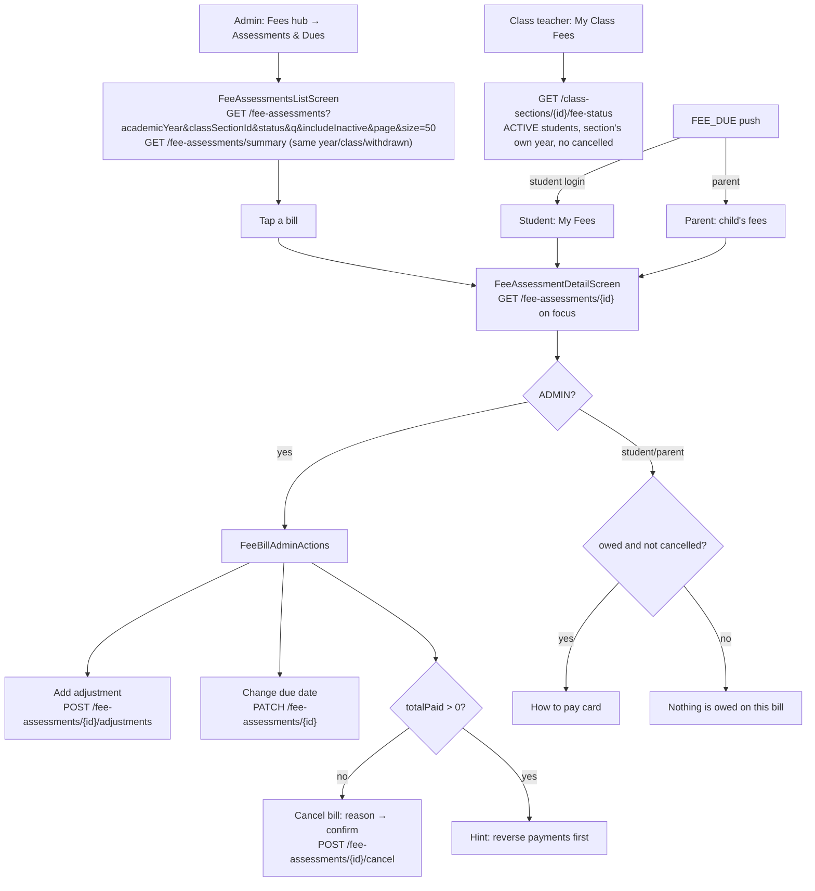

# Fees Overview, Bills & My Class Fees — Flow

## Overview
Everything about reading and correcting `StudentFeeAssessment` bills: the admin's school-wide bill list (server filters for academic year, class, status, name/roll search and withdrawn students, plus a summary card of server totals), one bill's detail screen where an admin adds a concession, waiver, late fee or correction, moves the due date or cancels the bill, the family screens (My Fees, a child's fees, the same bill detail with a "How to pay" card), a class teacher's "My Class Fees", and the dues report. A bill shows **OVERDUE** as soon as its due date (India time) has passed with money still owed — no payment needed. Every response carries that derived status, and a nightly job keeps the stored column in step for the insights engine.

Source: `specs/fee-bills-and-dues` (finance fix 4). Statements about the server follow that spec's API contract.

## Actors / roles
- **ADMIN**: The bill list and summary (`GET /api/v1/fee-assessments`, `/summary`), any bill (`GET /api/v1/fee-assessments/{id}`), adjustments, due-date changes and cancelling, the dues report, any section's fee status. Sees who added an adjustment or cancelled a bill.
- **TEACHER**: "My Class Fees" for the section they are class teacher of (`GET /api/v1/class-sections/{id}/fee-status`). `GET /api/v1/fee-assessments/{id}` only as class teacher of the student's current section (no screen uses it). Every admin route is 403.
- **STUDENT**: My Fees (`GET /api/v1/students/{ownId}/fee-assessments`) → a bill's detail (`GET /api/v1/fee-assessments/{id}`, own bills only).
- **PARENT**: A child's fees (`ChildFeesScreen`, linked child only) → the same bill detail, now registered in `ParentNavigator`.
- Families see each adjustment's type, amount, reason and date, but `createdByName`/`cancelledByName` are `null` for them.

## Flow diagram

## Step-by-step

### Status rule (server, one rule everywhere)
1. `FeeStatusRule.compute(bill, todayIst)`: stored CANCELLED → CANCELLED; `totalPaid ≥ totalDue` → PAID; due date before today (IST) → OVERDUE; `totalPaid > 0` → PARTIAL; else UNPAID. A bill due today is not overdue. `daysOverdue = today − dueDate` while OVERDUE.
2. Lists, the status filter, the summary, the dues report, class fee status and reminders all use that rule (the list filter is the same rule as a SQL predicate). Every write (payment, adjustment, due-date change, re-price) also stores it, and `FeeStatusSyncJob` bulk-syncs the stored column at 00:05 IST for the insights engine (bulk updates skip the audit log).

### Admin bill list
3. `FeeAssessmentsListScreen` loads the summary and page 0 together. Defaults: the current academic year (April-March by IST date), ACTIVE students only, no cancelled bills.
4. Filters, all server-side: **Academic year** dropdown (the summary's year, every year with bills, and "All years" → `academicYear=ALL`); **Class** dropdown (sections of the chosen year, matched by canonical year, plus "All classes" → `classSectionId`); status chips (All, Unpaid, Part paid, Overdue, Paid, Cancelled — `status=CANCELLED` lists only cancelled bills); a search box (`q`, name contains or roll starts with, debounced 300 ms); "Show withdrawn students" (`includeInactive=true`).
5. Each request takes a number; a reply to a superseded request (the filters changed meanwhile) is dropped, so a slow old response can't overwrite a newer one. Pages of 50 load on scroll; the server caps `size` at 200 and sorts by student name, then bill id, so pages never repeat or skip a row.
6. The summary card shows the server's `billCount`, `unpaidCount`, `overdueCount` and `totalRemaining` for the chosen year, class and withdrawn setting — never sums of the rows loaded so far.
7. Rows show name, a "Withdrawn"/"Alumni" tag when `studentStatus` isn't ACTIVE, roll and amounts, the class label (`classSectionLabel`, the student's current section) and "Overdue by N days" in red or "Due 5 Nov 2026". Coming back from a bill reloads the list and the totals.

### Bill detail
8. `FeeAssessmentDetailScreen` paints the bill it was opened with, then fetches `GET /api/v1/fee-assessments/{id}` on every focus (with its adjustments). It shows the translated status chip, "Overdue by N days" / "Due …", a cancelled banner (date, reason, and who for an admin), totals, the formatted due date, and `FeeBillAdjustmentsCard` (the structure's fee, each adjustment as "Concession: -₹2,000 (Sibling)" with its date, and the total) when there are adjustments.
9. ADMIN — `FeeBillAdminActions` (hidden on a cancelled bill):
   - **Add adjustment**: type (Concession, Waiver, Late fee, Correction — with "Take off the fee"/"Add to the fee"), amount (a size; the app signs it by type), a "Waive all ₹X still owed" shortcut for a waiver, and a reason (1-500). The app previews the new total and refuses below what's paid; the server re-checks under a row lock: 409 `FEE_TOTAL_BELOW_PAID`, 409 `FEE_BILL_CANCELLED`, 400 for a wrong sign, 0, 3 decimals or a missing reason.
   - **Change due date**: a date within two years either side of today → `PATCH {dueDate}`; the status follows at once (moving it to yesterday makes the bill OVERDUE, "Overdue by 1 day").
   - **Cancel bill**: only while `totalPaid == 0` (otherwise the button is hidden with "Reverse them first, then cancel the bill"); a reason, then a confirmation alert. The bill becomes CANCELLED with `remainingDue` 0, keeps its amounts for the record, and drops out of the default list, summary, dues, class fee status and reminders. Cancelling again is a no-op; there is no un-cancel.
   - Each action replaces the bill with the server's response; errors show through `getErrorMessage` (`errors.codes.*`).
10. STUDENT/PARENT — while something is owed and the bill isn't cancelled, a "How to pay" card: pay at the school office by cash, cheque or bank transfer and keep the receipt; paying in the app is coming later. Otherwise "Nothing is owed on this bill.".

### Families
11. `MyFeesScreen` and `ChildFeesScreen` list a student's bills (newest year first, cancelled ones included) with the translated chip and "Overdue by N days" / "Due …" / "Cancelled". Both re-fetch on focus; ChildFees rows now open the bill detail.
12. A `FEE_DUE` push opens ChildFees for a parent and My Fees for a student (sent to the student's login when no parent is linked) — `notificationTarget` in `src/utils/notificationRouting.ts`.

### My Class Fees (class teacher)
13. `MyClassFeesScreen` → `GET /api/v1/class-sections/{id}/fee-status`: ACTIVE students only, no cancelled bills, only the section's own (canonical) academic year, by roll number then name — a promoted class no longer shows last year's arrears. Pull to refresh; on an error, "Try again". Rows show the translated chip and the overdue marker; the summary is fully paid / total and remaining ₹.

### Dues report (no screen yet)
14. `GET /api/v1/reports/dues?academicYear=` (ADMIN; default current year, `ALL` allowed): `unpaid…` are ACTIVE students' non-cancelled bills with money owed, by name; `overdue…` the OVERDUE subset by the rule above (never-paid bills included), by due date then name; `inactiveStudentsUnpaidCount`/`TotalUnpaid` the open bills of students who have left, for the admin to cancel. `getDuesReport(schoolId, academicYear?)` exists in the app; no screen calls it.

## Backend endpoints involved
| Endpoint | Roles | Notes |
|---|---|---|
| `GET /api/v1/fee-assessments` | ADMIN | `status?`, `classSectionId?`, `academicYear?` (default current, `ALL`, either spelling), `q?` (≤ 100), `includeInactive?`, `page`, `size` (clamped 1-200); sorted by name then id |
| `GET /api/v1/fee-assessments/summary` | ADMIN | `FeeAssessmentSummary` over non-cancelled bills (`cancelledCount` aside) |
| `GET /api/v1/fee-assessments/{id}` | ADMIN; STUDENT own; PARENT linked child; TEACHER class teacher of the student's current section | with `adjustments` |
| `PATCH /api/v1/fee-assessments/{id}` | ADMIN | `{dueDate}` within today ± 2 years |
| `POST /api/v1/fee-assessments/{id}/adjustments` | ADMIN | `{type, amount, reason}` |
| `POST /api/v1/fee-assessments/{id}/cancel` | ADMIN | `{reason}`; 409 `FEE_BILL_HAS_PAYMENTS` |
| `GET /api/v1/students/{id}/fee-assessments` | ADMIN, TEACHER, STUDENT, PARENT (service-checked) | with `adjustments`, cancelled included, newest year first |
| `GET /api/v1/class-sections/{id}/fee-status` | TEACHER, ADMIN (class teacher checked) | see step 13 |
| `GET /api/v1/reports/dues` | ADMIN | see step 14 |

Every bill in every response (`FeeAssessmentResponse`) now also has `studentStatus`, `classSectionId`, `classSectionLabel`, `baseAmount`, `adjustmentsTotal`, `overdue`, `daysOverdue`, `cancelled`, `cancelledAt`, `cancelledByName`, `cancelReason` and `adjustments` (an array on single bills, a student's bills and write responses; `null` on paged lists, class fee status, the dues report and generate results). `remainingDue` is 0 for a cancelled bill.

## Frontend screens involved
- `src/screens/principal/FeeAssessmentsListScreen.tsx` — admin list, filters, summary card, stale-response guard.
- `src/screens/principal/FeeAssessmentDetailScreen.tsx` — bill detail for every role; `src/components/fees/FeeBillAdjustmentsCard.tsx`, `FeeBillAdminActions.tsx`, `HowToPayCard.tsx`.
- `src/screens/principal/MyFeesScreen.tsx`, `ChildFeesScreen.tsx` — family lists; `src/navigation/ParentNavigator.tsx` registers `FeeAssessmentDetail`.
- `src/screens/principal/MyClassFeesScreen.tsx` — class teacher view.
- `src/utils/feeBills.ts` — `feeStatusVariant`/`feeStatusLabel` (one chip colour and label for every fee screen), `billDueNote`, `formatDueDate`, `adjustmentDraft`, `signedAdjustmentAmount`, `formatAdjustmentLine`, `canCancelBill`, `dueDateChangeBounds`, `academicYearOptions`, `sectionsForYear`, `feeAssessmentQuery`, `studentLeftTagKey`, `formatAmount`.
- `src/api/feeAssessments.ts` — `listFeeAssessments(schoolId, filters, page, size)`, `getFeeAssessmentSummary`, `getFeeAssessment`, `updateFeeAssessmentDueDate`, `addFeeAdjustment`, `cancelFeeAssessment`, `listStudentFeeAssessments`, `getClassSectionFeeStatus`, `getDuesReport(schoolId, academicYear?)`.

## Data model
- `StudentFeeAssessment`: `baseAmount`, `totalDue` (= base + sum of adjustments, never below `totalPaid` or 0), `totalPaid`, `status` (`UNPAID`, `PARTIAL`, `OVERDUE`, `PAID`, `CANCELLED`), `dueDate`, `academicYear` (canonical `YYYY-YY`), `cancelledAt`, `cancelledById`, `cancelledByName`, `cancelReason`.
- `FeeAdjustment`: `assessment`, `adjustmentType` (`CONCESSION` < 0, `WAIVER` < 0, `LATE_FEE` > 0, `CORRECTION` either), `amount` (signed, 12/2), `reason` (≤ 500), `createdById`, `createdByName`, timestamps. There is no delete; undo with an opposite correction.

## Known limitations / edge cases
- **Default year hides arrears**: the list, summary and dues report default to the current academic year; last year's unpaid bills need "All years" (or that year).
- **The stored status can lag** the derived one until 00:05 IST; only the insights engine reads the stored column.
- **No un-cancel**, no undo of an adjustment (add an opposite correction), no bulk due-date move for a structure, no instalments.
- **Class label is the current section**: a bill from a year before a promotion shows the student's present class.
- A teacher who is class teacher of more than one section only reaches the first from the dashboard.
- Old app builds: the admin list now defaults to the current year, active students and no cancelled bills, while its summary card still sums loaded rows; family screens show a raw `CANCELLED` chip (old colour logic) without crashing.
